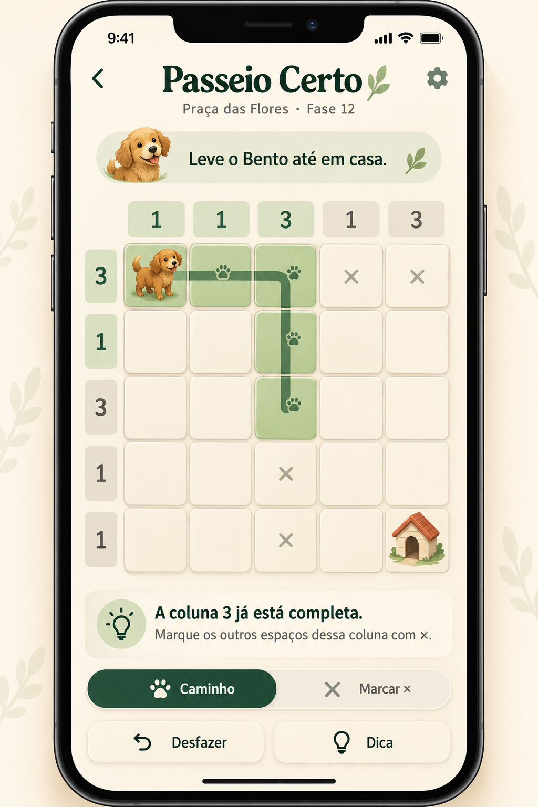

# Passeio Certo 🐾

Um jogo de lógica para iPhone: descubra o caminho que leva Bento até casa usando pistas numéricas nas linhas e colunas.

**Tecnologia planejada:** SwiftUI + núcleo em Swift puro. Fases geradas e verificadas localmente, com funcionamento offline.

## Comece aqui

- [Board de desenvolvimento no Trello](https://trello.com/b/5ryzhOIc/passeio-certo)
- [Plano completo: marcos, dependências e critérios de aceite](docs/plano.md)
- [Regras propostas do puzzle](docs/regras.md)
- [Direção visual e referência aprovada](docs/design.md)
- [Backlog estruturado com links para os cartões](docs/backlog.json)

O plano tem **26 tarefas para o primeiro beta** e **7 ideias pós-MVP**. As primeiras tarefas prontas para começar são:

1. [PC-001 · Preparar o projeto iOS em SwiftUI](https://trello.com/c/DTdqCQ67)
2. [PC-002 · Fechar as regras e criar fases de referência](https://trello.com/c/jSJI6UTs)
3. [PC-009 · Criar o DesignSystem a partir do esboço aprovado](https://trello.com/c/j97mpHNp)

## Estado atual

Este primeiro commit contém **planejamento e referência visual**. O projeto executável SwiftUI começa em PC-001; ainda não há um app ou gerador implementado neste repositório. Os critérios de aceite dos cartões não significam funcionalidades já prontas.

## Primeiro beta

Um cachorro, uma praça e grades 5×5. Desenhar o caminho, marcar ×, desfazer, receber dicas explicadas, continuar partidas e ver o cachorro chegar em casa. Depois do primeiro marco jogável com fases fixas, integrar geração automática, tutorial, desafio diário e personalização.

Cada fase gerada precisa passar por duas verificações: **solução única** e **resolução por deduções suportadas, sem chute**. Uma não substitui a outra.

Sem servidor, chamadas de IA, anúncios ou vidas no MVP. O primeiro objetivo de distribuição é TestFlight; publicação pública é uma decisão posterior.

## Conceito visual aprovado

O esboço orienta a aparência. Tabuleiro, números, caminho e controles serão nativos e calculados por código; a imagem não será usada como uma tela pronta.
